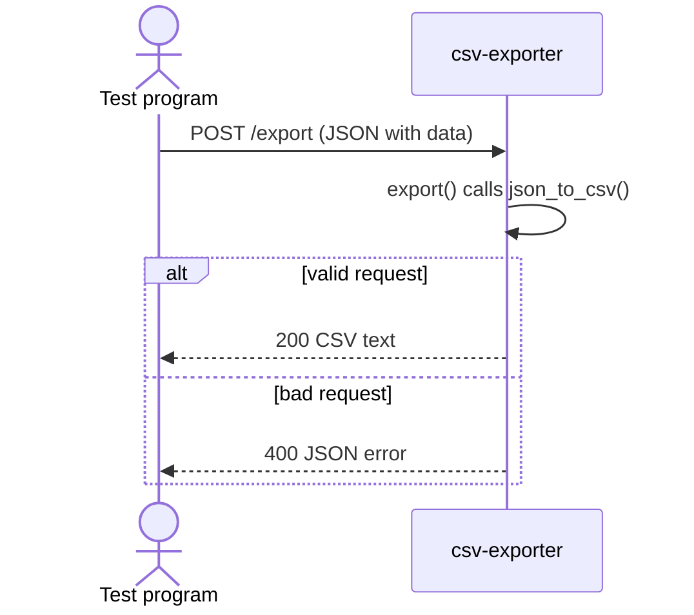

# CSV Exporter

Converts a list of JSON records into CSV text that opens in Excel, Google Sheets,
or imports into a database. Nested objects become dotted columns (`device.ip`),
lists become one cell joined by semicolons (`22;80`), and records with different
keys are lined up under one header.

- Endpoint: `POST http://localhost:3002/export`
- Communication: REST API (HTTP + JSON in, CSV out)

## Run it

From the repo root:

```sh
docker compose up --build -d csv-exporter
docker compose ps                     # csv-exporter should be "Up" on 127.0.0.1:3002->8000/tcp
docker compose logs csv-exporter      # look for "Application startup complete"
```

`csv-exporter/` is mounted into the container, so edits to `main.py` or
`converter.py` reload live. After changing `requirements.txt`, rebuild with
`docker compose up --build -d csv-exporter`.

## How to request data

Send a `POST` to `/export` with a JSON body:

| Field      | Required | Description |
| ---------- | -------- | ----------- |
| `data`     | yes      | List of JSON objects. Each object becomes one row. |
| `columns`  | no       | List of column names, in the order you want. If left out, every key is included in the order first seen. |
| `filename` | no       | Name for the CSV file. This defaults to `export.csv`. |

Example request (Python):


```python
TODO: paste the request half of your test program here
```

## How to receive data

The CSV comes back as the response to the same request.

- **Success:** `200 OK`, `Content-Type: text/csv`. The body is the CSV text:
  the first line is the header, each following line is one record. The
  `Content-Disposition` header carries the filename.
- **Failure:** `400`, `Content-Type: application/json`:
  `{"error": "INVALID_INPUT", "message": "<what went wrong>"}`

Example of receiving (Python):

```python
TODO: paste the response-handling half of your test program here
```

## UML sequence diagram



## Examples

| Test | Request body | Status | Response |
| ---- | ------------ | ------ | -------- |
| Basic (story 1) | `{"data": [{"date": "2026-11-01", "exercise": "Squat", "sets": 3, "reps": 10}]}` | 200 | `date,exercise,sets,reps`<br>`2026-11-01,Squat,3,10` |
| Commas & quotes (story 1) | `{"data": [{"ip": "192.168.1.1", "hostname": "router, upstairs", "notes": "runs \"dnsmasq\""}]}` | 200 | `ip,hostname,notes`<br>`192.168.1.1,"router, upstairs","runs ""dnsmasq"""` |
| Nested + list (story 2) | `{"data": [{"date": "2026-11-01", "exercise": {"name": "Squat", "equipment": {"type": "barbell"}}, "sets": 3, "reps": [10, 8, 6]}]}` | 200 | `date,exercise.name,exercise.equipment.type,sets,reps`<br>`2026-11-01,Squat,barbell,3,10;8;6` |
| Uneven keys (story 2) | `{"data": [{"date": "2026-11-01", "exercise": "Squat"}, {"date": "2026-11-02", "notes": "felt strong"}]}` | 200 | `date,exercise,notes`<br>`2026-11-01,Squat,`<br>`2026-11-02,,felt strong` |
| Bad JSON | `not json` | 400 | `{"error":"INVALID_INPUT","message":"Request body must be valid JSON."}` |
| Empty data | `{"data": []}` | 400 | `{"error":"INVALID_INPUT","message":"data must be a non-empty array of objects"}` |

## Calling it from TypeScript

```ts
const response = await fetch("http://localhost:3002/export", {
  method: "POST",
  headers: { "Content-Type": "application/json" },
  body: JSON.stringify({
    data: [
      { date: "2026-11-01", exercise: "Squat", sets: 3, reps: 10 },
      { date: "2026-11-02", exercise: "Bench Press", sets: 4, reps: 8 },
    ],
    filename: "workouts_nov.csv",
  }),
});

if (!response.ok) {
  const error = await response.json();
  throw new Error(`${response.status}: ${error.message}`);
}

const csv = await response.text();
console.log(csv);
```