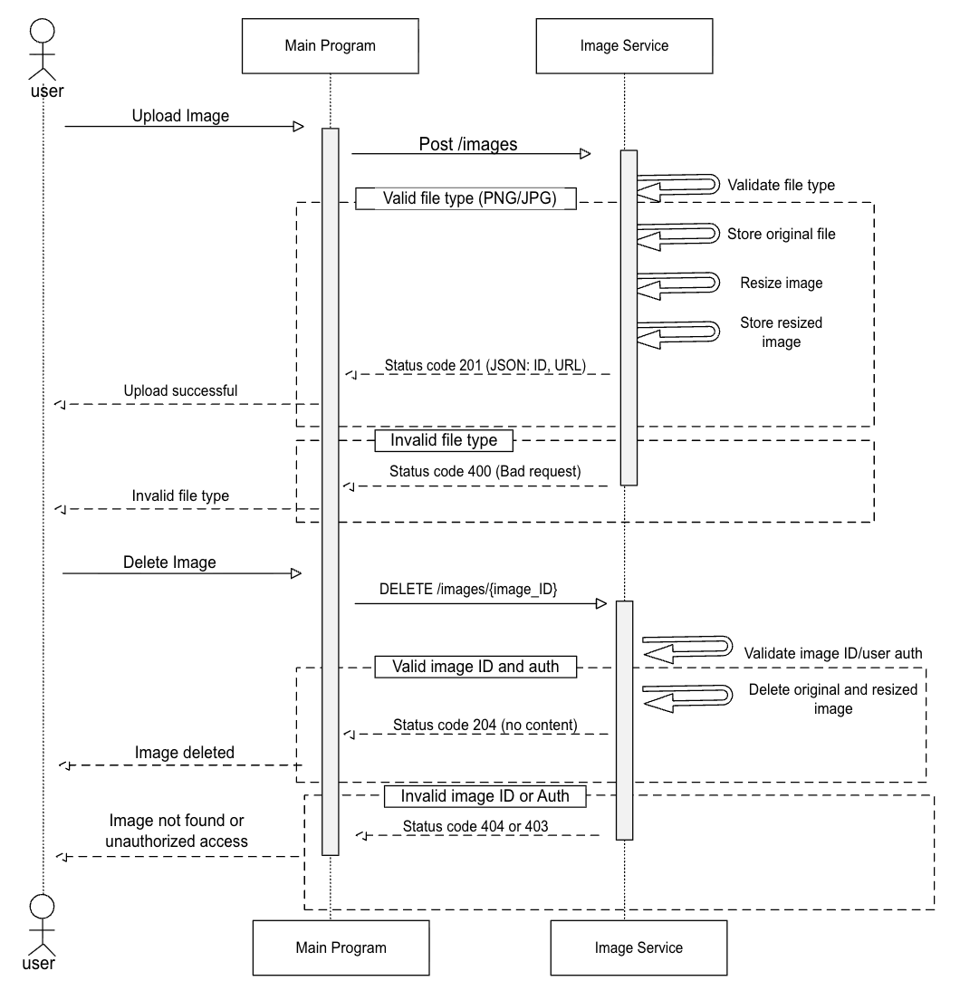

# Using Images Microservice
This program uses a Python/Flask Framework 

## Testing Image Microservice

1. Open a terminal and navigate to the project directory:\
`cd pnw-monoliths-pool/image_service`

2. Create a python virtual environment\
`python3 -m venv .venv`

3. Active the virtual environment\
`source .venv/bin/activate`

4. Install dependencies:\
`python3 -m pip install -r requirements.txt`

5. Start the app: \
Navigate into the src directory and start flask application:
```sh
cd src
python3 app.py
```
The Flask server should now be running at:
http://localhost:5001

### The tester program supports the following operations:

- Upload an image: Select a JPG or PNG image and click Upload. A success message and image ID should appear.

- Retrieve an image: Enter the image ID returned during upload and click Retrieve. The uploaded image should appear on the page.

- Delete an image: Enter the image ID and click Delete. A message should confirm whether the image was successfully deleted.

# Example calls 
## To request data from the microservice:
- Data is requested via HTTP GET requests. When you press the "retrieve" button on the form, it sends a GET request to the microservice for the image file corresponding to the ID provided.

| Request                    | Status | Body                                                        |
| -------------------------- | ------ | ----------------------------------------------------------- |
| `GET /images/<img_id>`           | 200    | The requested image (JPG or PNG) |
| `GET /images/<img_id>`  | 400    | `{"error": "Invalid image ID"}`           |
| `GET /images/<img_id>`  | 404    | `{"error": "Image not found"}`    |

### Example for how to programatically to request data from the microservice:
```py
import requests
from PIL import Image
from io import BytesIO

image_id = "40290"
url = f"http://localhost:5001/images/{image_id}"

response = requests.get(url)

if response.status_code == 200:
    image = Image.open(BytesIO(response.content))
    image.show()

    print("Image retrieved and displayed successfully!")

else:
    print("Error:", response.status_code)
    print(response.json())
```

## To receive data from the microservice:
- Data is received via HTTP POST requests. When you press the "Upload" button on the form, it sends a POST request to the microservice for the image file to be processed and stored

| Request                    | Status | Body                                                        |
| -------------------------- | ------ | ----------------------------------------------------------- |
| `POST /images`           | 20    |  JSON containing image ID and success message|
| `POST /images`  | 400    | `{"error": "Only JPG and PNG file types allowed!}`           |
| `POST /images`  | 400    | `{"error": "No image added"}`    |

### Example for how to programatically to receive data from the microservice:
```py
import requests

url = "http://localhost:5001/images"

with open("example.jpg", "rb") as image:
    response = requests.post(
        url,
        files={"file": image}
    )
if response.status_code == 201:
    data = response.json()
    print("Image ID:", data["imageID"])
    print("Message:", data["message"])

else:
    print("Error:", response.json())

```

# Image Microservice UML Diagram:
