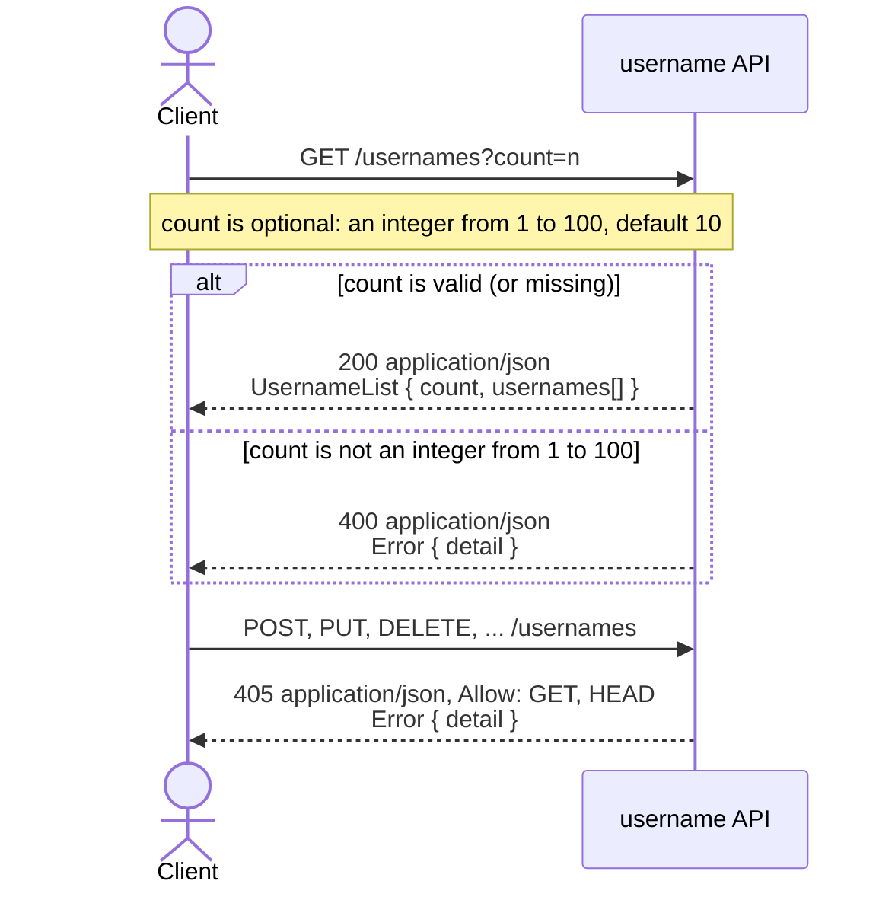

# usernames

Generates random usernames like `braveotter`. TypeScript + Express; spec in `openapi.json`.

- Endpoint: `GET http://localhost:3001/usernames` (under `docker compose`)
- Communication: REST API (HTTP, JSON out)

## Run it

From the repo root: `docker compose up --build -d username`. `src/` is mounted, so edits
reload live. After adding a package (`npm install <pkg>` in this folder), rebuild with the
same command.

Alone, without Docker: `npm install && npm start` (http://localhost:3000).

## How to request data

Send a `GET` to `/usernames`. One optional query parameter:

| Parameter | Description |
| --------- | ----------- |
| `count`   | How many usernames, an integer from 1 to 100. Defaults to 10. |

```ts
const res = await fetch('http://localhost:3001/usernames?count=3');
```

## How to receive data

The response is JSON:

| Status | When | Body |
| ------ | ---- | ---- |
| 200 | `count` is valid or left out | `{"count": 3, "usernames": ["quietfox", "boldowl", "calmseal"]}` |
| 400 | `count` isn't an integer from 1 to 100 | `{"detail": "count must be an integer between 1 and 100"}` |
| 405 | Any method other than GET or HEAD | `{"detail": "Method not allowed"}` |

```ts
const body = await res.json();
if (res.ok) {
  console.log(body.usernames);              // ["quietfox", "boldowl", "calmseal"]
} else {
  console.error(res.status, body.detail);   // 400 count must be an integer between 1 and 100
}
```

## Test program

The **Username generator** panel in the repo's `test.html` calls the service with
`getUsernames(count)`. It only talks to the service over HTTP (`fetch`) and never imports
its code. Open `test.html` in a browser and press **Send request**.

## UML sequence diagram


