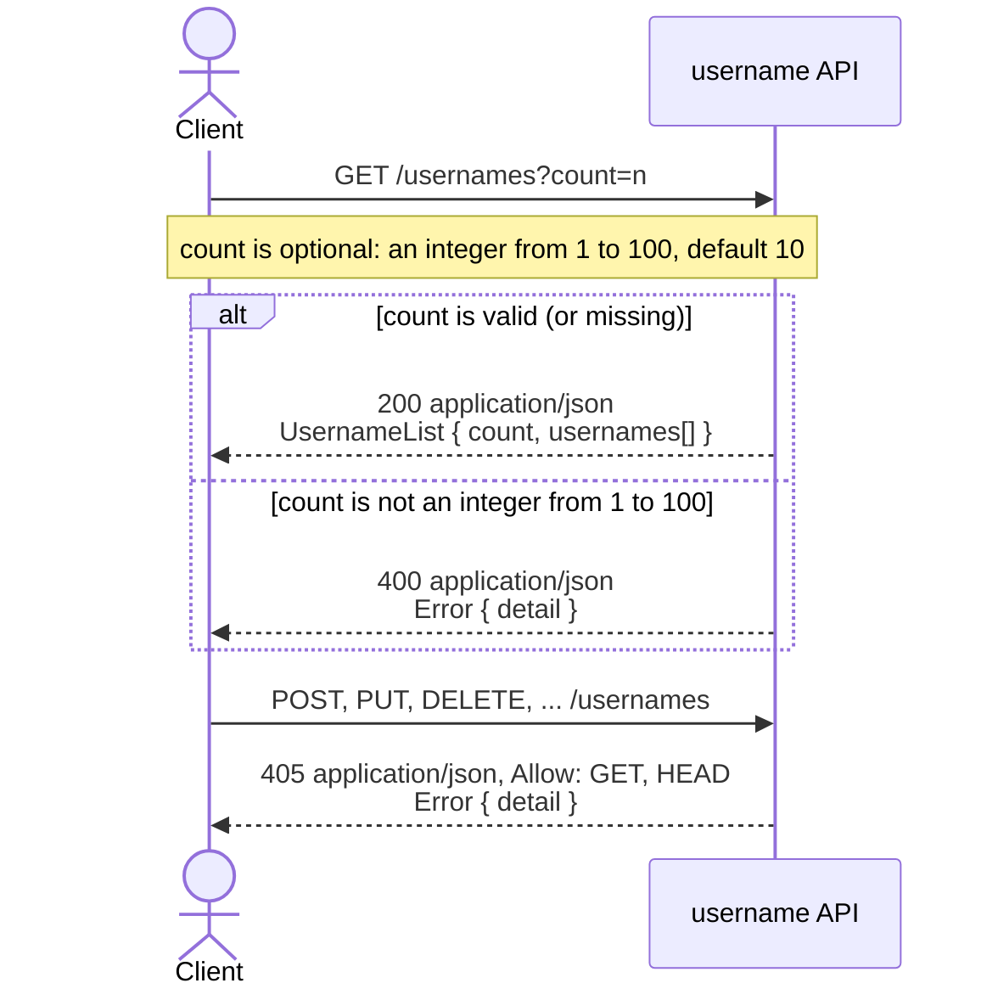

# usernames

TypeScript + Express. spec in `openapi.json`.
Node 24 runs `src/index.ts` directly, with no build step.

Run alone:

```sh
npm install
npm start            # http://localhost:3000
npm run typecheck
```

Under `docker compose up` (from the repo root), `src/` is mounted and edits reload live.

To add a package, run `npm install <pkg>` here (it updates `package.json` and
`package-lock.json`), then rebuild: `docker compose up --build -d app1`. The image
runs `npm ci`, which fails if the lockfile doesn't match `package.json`, so don't
edit `package.json` by hand without running `npm install`.

Or with Docker: `docker build -t username . && docker run -p 3000:3000 username`.

## Requests and responses

What a client can send and what it gets back. Other methods get a 405, which
`openapi.json` doesn't list yet.



Examples:
``


| Request                    | Status | Body                                                        |
| -------------------------- | ------ | ----------------------------------------------------------- |
| `GET /usernames`           | 200    | `{"count":10,"usernames":["braveotter", ...]}`              |
| `GET /usernames?count=3`   | 200    | `{"count":3,"usernames":["quietfox","boldowl","calmseal"]}` |


## Fetching usernames with TypeScript


```ts
type UsernameList = {count: number; usernames: string[]};
type ApiError = {detail: string};

const BASE_URL = 'http://localhost:3000';

async function fetchUsernames(count?: number): Promise<string[]> {
  const url = new URL('/usernames', BASE_URL);
  if (count !== undefined) url.searchParams.set('count', String(count));

  const res = await fetch(url);
  if (!res.ok) {
    const error = (await res.json()) as ApiError;
    throw new Error(`${res.status}: ${error.detail}`);
  }

  const body = (await res.json()) as UsernameList;
  return body.usernames;
}

console.log(await fetchUsernames());     // 10 usernames
console.log(await fetchUsernames(3));    // 3 usernames
await fetchUsernames(0).catch((e) => console.error(e.message));
// 400: count must be an integer between 1 and 100
```
